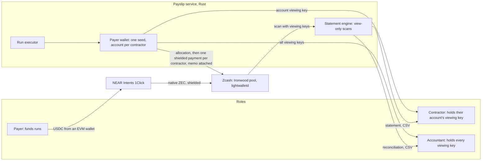

# Payslip

Private payroll on Zcash. Every payment is shielded. The contractor and the accountant each hold a viewing key that reveals exactly their slice, with USD cost basis and period statements ready for tax.

Private to the world, transparent to your accountant.

Built for the Zcash track of Colosseum's [Crypto World's Fair](https://colosseum.com/worldsfair). Submission closes 12 Oct 2026, 11:59pm PT.

## What it does

A DAO or remote-first team pays 5 to 50 contractors on-chain. Today every salary is readable on a block explorer. With Payslip:

- The payer funds a run in USDC from their own wallet. NEAR Intents swaps it into native ZEC, delivered into the shielded Ironwood pool. The fill rate becomes the run's USD basis.
- Each contractor is paid with one shielded transaction from a dedicated ZIP-32 account. The memo carries run id, period, invoice reference and the USD basis.
- Each contractor receives the full viewing key of their own account. It shows their payments and nothing else, because that account pays nobody else.
- The accountant receives every account's viewing key: every run, every line, no spending power.
- The statement engine scans the chain with those keys, decodes the memos and renders per-contractor statements and a reconciliation of funded USD against paid USD per run, with the variance explained. CSV export, PDF through print.
- A contractor who does not want ZEC can choose to have their pay converted to USDC on receipt, with the privacy cost of that leg stated plainly.

There is no smart contract. Zcash has none. Payslip is a service plus a wallet library: the chain holds shielded payments and memos; the service holds keys and renders statements.

## Proof

### Mainnet demo run

A judge should be able to open every txid below in a Zcash explorer and see a shielded transaction with no amount and no parties.

| Item | Value |
| --- | --- |
| Network | Zcash mainnet |
| Demo run | VERIFY: `scripts/mainnet-demo.sh scripts/demo/mainnet.env` writes the run id, six txids and heights to `scripts/demo/out/proof-mainnet-<run>.md`; they are copied here |
| Demo video | VERIFY: link added after recording (see `docs/DEMO.md`) |

### Testnet runs (already on chain)

The same flow, run on Zcash testnet (NU7) through the API and the web app. Open any txid at `https://testnet.zecblock.com/tx/<txid>`.

| Run | What | Evidence |
| --- | --- | --- |
| 284c2421 | Six contractors through `scripts/mainnet-demo.sh` (rehearsal) | [docs/proof/testnet-rehearsal-284c2421.md](docs/proof/testnet-rehearsal-284c2421.md): six payments at heights 4,465,683 to 4,465,684, reconciled |
| 9145b60b | First API run, three contractors | Payments [3c5513c5...](https://testnet.zecblock.com/tx/3c5513c5aaee0def9244a5fb02a32681a0c9b0046a0e1a16b1964c8ede83bd08) (4,465,671), [a21fabe2...](https://testnet.zecblock.com/tx/a21fabe27fc81085dd47b5e59bf04f466bda90ec12b24f151248484593691b62), [3952333d...](https://testnet.zecblock.com/tx/3952333d5466eed83b3fc3bad1ee82865708e54500c0d0520bad5d90d0464026) (4,465,672) |
| d9248c70 | A contractor who converts to USDC (simulated on testnet) | [118c665f...](https://testnet.zecblock.com/tx/118c665f71d082eba1f02777f3d271fc111716725ee4b256c6c3b9bcccae33ca) (4,465,711): ZEC to the venue deposit, memo on the change output |

Round-by-round results: [docs/TEST-REPORT.md](docs/TEST-REPORT.md). The demo click path and timings: [docs/DEMO.md](docs/DEMO.md).

## Why Zcash, why now

- Ironwood shielded pool (NU6.3, live on mainnet since 28 Jul 2026): every payment lands in it. No new value may enter Orchard; payments to a unified address's Orchard receiver are delivered into Ironwood in v6 transactions.
- ZIP-32 accounts and ZIP-316 unified full viewing keys: one account per contractor is the only key arrangement where a viewing key reveals exactly one person's payments. A payer-level key cannot be narrowed to one recipient.
- ZIP-302 memos (512 bytes): enough for a structured pay line that survives in the chain itself, so statements need nothing but the key.
- NEAR Intents 1Click now delivers USDC to native ZEC straight into Ironwood for a unified address (verified on chain, see `docs/TECH-DECISIONS.md`), so payroll can start from dollars.

## How it works



1. **Onboard.** The payer adds a contractor's unified address. The service creates the next ZIP-32 account and offers that account's unified full viewing key as text and QR.
2. **Fund.** The payer enters USD amounts and invoice references. On the Fund step the web app asks 1Click for a quote and deposit address, then sends USDC from the payer's connected wallet with chain and amount pre-filled. The ZEC that arrives in the treasury (account 0) is measured by scanning, and funded USD divided by that ZEC is the run's fill rate.
3. **Pay.** One allocation transaction moves each line's ZEC plus its fee from the treasury into that contractor's account (memo `PS1A`, plus a `PS1R` funding record on the treasury's change, readable only with the treasury key). Then each contractor account sends one shielded payment to its contractor with memo `PS1|run|period|invoice|usd_cents|rate`. Every transaction is stored and its txid persisted before broadcast, so a crash never pays twice.
4. **State.** The contractor pastes their key and gets a statement: date, ZEC, USD basis, rate, invoice, txid, height, running totals. The accountant loads every key and gets a reconciliation per run: funded USD against paid USD, with the variance explained by network fees and unspent ZEC at the fill rate. Anything without a Payslip memo is listed as unlabelled, never dropped.

Design and every decision with its reason: [docs/SPEC.md](docs/SPEC.md), [docs/TECH-DECISIONS.md](docs/TECH-DECISIONS.md), [docs/API.md](docs/API.md), [docs/DESIGN.md](docs/DESIGN.md).

## Quick start (testnet)

Requirements: Rust 1.94 or newer (`rustup update stable`), Node 22 or newer with pnpm 11 (`corepack enable` or `npm i -g pnpm@11`), git, curl and python3. macOS or Linux.

1. Clone and configure the service:

   ```
   git clone https://github.com/pratikasr/payslip.git
   cd payslip/service
   printf 'ZCASH_NETWORK=testnet\nPAYSLIP_SEED_PASSPHRASE=%s\n' "$(openssl rand -hex 16)" > .env
   ```

   `.env.example` lists every other setting with a one-line explanation; the defaults suit testnet.

2. Build and create the encrypted payer seed. This prints the treasury's testnet address.

   ```
   cargo build --release
   ./target/release/payslip-service init
   ```

3. Fund the treasury with testnet coins: paste the treasury address into https://faucet.testnet.valargroup.dev/ (0.125 TAZ per IP address per day). One payout covers several six-contractor runs (each draws about 0.025 TAZ at the testnet fixed rate). Wait for one confirmation, under a minute on testnet.

4. Start the service (leave it running):

   ```
   ./target/release/payslip-service serve
   ```

5. In a second terminal, start the web app:

   ```
   cd payslip/web
   pnpm install
   pnpm build
   pnpm start
   ```

6. Open http://127.0.0.1:3000 (prefer this to `localhost`, which on some machines resolves to an IPv6 address another local app may hold). If port 3000 is taken, run `pnpm start -p 3100` and add `PAYSLIP_WEB_ORIGIN=http://127.0.0.1:3100` to `service/.env`, then restart the service. Under Payer, add contractors (or run `scripts/seed-testnet-contractors.sh` from the repository root to add six with test addresses), create a run, confirm funding, and execute it. Then open a contractor's viewing key on the Contractor page and every key on the Accountant page.

The whole six-contractor flow also runs from one command, which is the script used for the mainnet demo: `scripts/mainnet-demo.sh scripts/demo/testnet-rehearsal.env`.

On testnet there is no USDC venue (1Click has no testnet), so a clearly labelled fixed-rate testnet venue draws the run's coins from the treasury. It cannot be enabled on mainnet.

## Mainnet

`scripts/mainnet-demo.sh scripts/demo/mainnet.env` runs the same six-contractor demo on mainnet with NEAR Intents: fill in `scripts/demo/mainnet.env` from `mainnet.env.example` and the contractors file from `scripts/demo/contractors.example.json`, then deposit the USDC it asks for from the web app's Fund step. It stops before funding unless confirmed. See [docs/DEMO.md](docs/DEMO.md).

## Tests

```
cd service && cargo test                                   # unit and executor tests, no network
cd service && ZCASH_NETWORK=testnet LIGHTWALLETD_URL=https://testnet.zec.rocks:443 cargo test --test testnet
cd service && cargo clippy --all-targets -- -D warnings && cargo audit
cd web && pnpm lint && pnpm typecheck && pnpm build
cd web && pnpm e2e                                         # browser tests: demo script, keyboard, camera QR, wallet funding
python3 scripts/adversarial-testnet.py                      # adversarial scenarios against a testnet service
```

CI runs formatting, clippy, tests and audit for the service and lint, typecheck and build for the web on every push.

## Repository layout

| Path | What |
| --- | --- |
| `service/` | Rust service on `zcash_client_backend` 0.25.0-pre.0: wallet core, run executor, swap venues, statement engine, HTTP API |
| `web/` | Next.js 15 app: landing page, payer, contractor and accountant dashboards |
| `docs/` | Spec, technical decisions and verified facts, API, design, test report, demo, progress log |
| `scripts/` | Demo driver, testnet seeding, clean environments, adversarial suite |
| `CLAUDE.md` | Guide for coding agents working in this repo |

## Status

| Milestone | State |
| --- | --- |
| M0 Verify external facts | done |
| M1 Scaffold service and web | done |
| M2 Wallet core (accounts, FVK export, sync, send with memo) | done, verified on testnet |
| M3 Runs (API, swap venue, executor) | done, verified on testnet |
| M4 Statement engine | done, verified on testnet |
| M5 Web dashboards | done, verified on testnet |
| M6 Mainnet demo run | scripted, rehearsed on testnet and dry-run on mainnet up to the deposit; needs the USDC deposit |
| M7 Submission | prepared (docs/SUBMISSION.md); needs the team's Colosseum account |

## How it is judged (Rules §8 and FAQ)

| Criterion | How Payslip answers it |
| --- | --- |
| Functionality | A real payroll run on Zcash, visible in the explorer as shielded transactions, read back by the contractor's and accountant's keys |
| Potential impact | On-chain payroll is public by default everywhere; the buyer is every DAO and remote team paying in crypto |
| Novelty | Per-contractor viewing keys plus a statement engine that reconciles funded USD against paid USD from the chain alone |
| UX | Fund from a USDC wallet, pay in one click, statements by pasting a key; the user never handles a z-address |
| Open source | This repo, MIT |
| Business plan | Per-seat monthly fee per contractor plus a spread on the stablecoin to ZEC leg |

## Disclosures

- Pre-existing code: none. Everything in this repository was written for this hackathon. Third-party libraries are dependencies listed in `service/Cargo.lock` and `web/pnpm-lock.yaml`. The `zcash/zcash-devtool` repository was read as a reference for how to call the wallet crates; no code was copied from it.
- AI tools: Claude (Anthropic) via Claude Code, used for research, specification and code generation.

## License

MIT. See [LICENSE](LICENSE).
