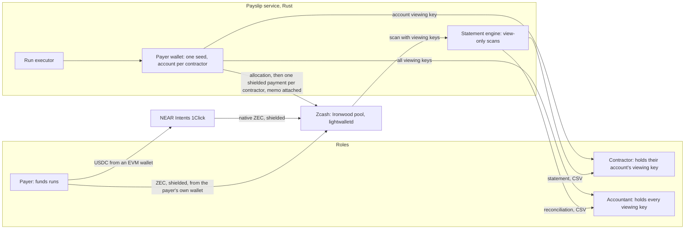

# Payslip

Private payroll on Zcash. Every payment is shielded. The contractor and the accountant each hold a viewing key that reveals exactly their slice, with USD cost basis and period statements ready for tax.

Private to the world, transparent to your accountant.

Built for the Zcash track of Colosseum's [Crypto World's Fair](https://colosseum.com/worldsfair). Submission closes 12 Oct 2026, 11:59pm PT.

## What it does

A DAO or remote-first team pays 5 to 50 contractors on-chain. Today every salary is readable on a block explorer. With Payslip:

- **Fund with ZEC or USDC.** The payer funds a run with ZEC sent shielded from their own wallet to the treasury: the run is funded when the deposit confirms, and the market rate of that block becomes the USD basis (ADR-025). Nothing on any public chain shows the payroll total. Or with USDC from an EVM wallet, which NEAR Intents swaps into native ZEC delivered into the shielded Ironwood pool, at a fill rate that becomes the USD basis.
- **Shielded pay lines.** Each contractor is paid with one shielded transaction from a dedicated ZIP-32 account. The memo carries run id, period, invoice reference and the USD basis.
- **Sign-in, organisation and roles.** On a hosted Payslip people sign in with Google, the first admin invites colleagues by link, and every member is an admin, approver, accountant or viewer. The service checks each request's token and role, and every change is on the audit log (ADR-026). Statements, proofs and the testnet demo need no account.
- **Recorded approvals.** With sign-in on, a run is paid only once the set number of admins or approvers have each approved it; at two or more, the person who created the run cannot approve it. The service holds the line: it refuses to pay a run short of approvals, even one resumed after a restart (ADR-029).
- **Pay schedules.** Under Settings the payer sets a cadence and a pay day. A few days before each pay day Payslip drafts the run from each contractor's usual amount or their approved payment request. The draft waits for a person to review, approve, fund and pay it; nothing moves on its own (ADR-028).
- **Payment requests.** A contractor sends a request from their portal (amount, period, invoice, due date, note), as Request Finance offers. The payer approves or rejects it from a queue; an approved request becomes a prefilled pay line, shows its transaction id in the contractor's portal once paid, and a request marked to repeat is sent again for the next period.
- **A viewing key per person.** Each contractor receives the full viewing key of their own account. It shows their payments and nothing else, because that account pays nobody else. The accountant receives every account's viewing key: every run, every line, no spending power.
- **Statements.** The contractor's portal scans the chain with their key, decodes the memos and lays out a statement of earnings: each payslip with its USD basis, invoice, txid and block, and on mainnet its market value when it arrived. CSV for Payslip, Koinly and CoinTracker; PDF through print.
- **Payment proofs.** A contractor shares a link that opens one payment and nothing else, checked against the chain at `/verify`, for a landlord, a bank or a visa office (ADR-021).
- **The accountant's reconciliation.** Books reconciles every run: funded USD against paid USD, with the variance explained by network fees and unspent ZEC at the run's rate, and anything without a Payslip memo listed rather than dropped. Exports for Xero and QuickBooks.
- **Convert on receipt.** A contractor who does not want ZEC can choose to have their pay converted to USDC on receipt, with the privacy cost of that leg stated plainly.

Every screen is printed on paper. A payslip is the white original of a pay advice; what the explorer sees is its yellow carbon copy, with every field the chain hides inked out (docs/DESIGN.md section 17).

There is no smart contract. Zcash has none. Payslip is a service plus a wallet library: the chain holds shielded payments and memos; the service holds keys and renders statements.

## Proof

### Testnet runs (already on chain)

The same flow, run on Zcash testnet (NU7) through the API and the web app. Open any txid at `https://testnet.zecblock.com/tx/<txid>`.

| Run | What | Evidence |
| --- | --- | --- |
| a738f61a | July 2026 payroll of the demo company (the judge kit's wallet), six contractors through the API, paid on 5 Oct 2026 to give the demo company history | [docs/proof/demo-wallet-runs.json](docs/proof/demo-wallet-runs.json): six payments at height 4,467,188; first payment [a90585cb...](https://testnet.zecblock.com/tx/a90585cbb49b663f1f1e809790cdcabeebd259c478f36ea0a4cefacbd820504c) |
| 67dd4c2e | August 2026 payroll of the same company, paid on 5 Oct 2026 to give the demo company history | [docs/proof/demo-wallet-runs.json](docs/proof/demo-wallet-runs.json): six payments at heights 4,467,193 to 4,467,196; first payment [2d77f686...](https://testnet.zecblock.com/tx/2d77f6864c9dbe69e897ae707f8711c92f3eb311dd511f872fead52ca5859be4) |
| 09019bd8 | September 2026 payroll of the same company: six contractors through the redesigned app, from the clean demo wallet | [docs/proof/rehearsal-3.json](docs/proof/rehearsal-3.json): six payments at height 4,466,912, reconciled within a cent of rounding; first payment [b597daba...](https://testnet.zecblock.com/tx/b597daba92b76495421d44c22b7c6282ca8f053cad6de06fdcb648a01d2bf0c3) |
| 284c2421 | Six contractors through `scripts/mainnet-demo.sh` (rehearsal) | [docs/proof/testnet-rehearsal-284c2421.md](docs/proof/testnet-rehearsal-284c2421.md): six payments at heights 4,465,683 to 4,465,684, reconciled |
| 9145b60b | First API run, three contractors | Payments [3c5513c5...](https://testnet.zecblock.com/tx/3c5513c5aaee0def9244a5fb02a32681a0c9b0046a0e1a16b1964c8ede83bd08) (4,465,671), [a21fabe2...](https://testnet.zecblock.com/tx/a21fabe27fc81085dd47b5e59bf04f466bda90ec12b24f151248484593691b62), [3952333d...](https://testnet.zecblock.com/tx/3952333d5466eed83b3fc3bad1ee82865708e54500c0d0520bad5d90d0464026) (4,465,672) |
| d9248c70 | A contractor who converts to USDC (simulated on testnet) | [118c665f...](https://testnet.zecblock.com/tx/118c665f71d082eba1f02777f3d271fc111716725ee4b256c6c3b9bcccae33ca) (4,465,711): ZEC to the venue deposit, memo on the change output. This conversion leg is public by design: the explorer shows the amount sent to the venue's deposit address |

Round-by-round results: [docs/TEST-REPORT.md](docs/TEST-REPORT.md). The demo click path and timings: [docs/DEMO.md](docs/DEMO.md).

### Mainnet demo run

The mainnet run (three real people with Zashi addresses, funded with ZEC from the owner's own wallet on the hosted app) and its video are pending the owner's ZEC and the three addresses; see [Status](#status).

## Check it yourself (for judges)

Payslip's claim is "private to the world, transparent to your accountant". Each half can be checked without trusting us:

1. **Private to the world.** Open any payroll payment above in the explorer. It is a shielded Ironwood transaction: no amount, no sender, no recipient. (The USDC conversion leg, run d9248c70, is the stated exception.)
2. **Transparent to the accountant.** The judge kit [docs/judge/judge-kit-testnet.json](docs/judge/judge-kit-testnet.json) holds the viewing keys of the demo accounts (no spending power), and a Payslip web app on testnet serves the same file, so there is nothing to download. In Books (`/books`, or Viewing as Accountant) choose **Load the judge kit**: every run, every line, funded against paid, read from the chain. In the contractor portal (`/portal`, or Viewing as Contractor) choose **Try it with a demo key**: Amara Okafor's payslips from the kit, and nobody else's. Where the kit is not served, Import key file in Books, or one contractor key pasted into the portal, does the same. The kit comes from a clean demo wallet that holds only the demo company's July, August and September payrolls (`run_ids` in the kit, [docs/proof/demo-wallet-runs.json](docs/proof/demo-wallet-runs.json); September is rehearsal 3), so every role sees the same three runs. All three were paid on 5 Oct 2026, so payslips and Books date them 5 Oct. Each key is also in the kit as `ufvk_wallet`, the ZIP 316 Revision 0 form (`uviewtest1...`) that released wallets import, so a key can be checked outside Payslip too. The mainnet kit is written by `scripts/mainnet-demo.sh` and published at `docs/judge/judge-kit-mainnet.json` after the mainnet run.
3. **One payment, nothing else.** The kit's `payment_proof` token opens a single payment. Open `/verify#<token>` on a Payslip web app: it fetches that transaction from the chain, decrypts that one output with the proof, and shows the amount, the address it went to and the memo. Change one character and it fails.

The hosted statements page is https://dkg1ye1jxb6hs.cloudfront.net (Books: Load the judge kit; the contractor portal: Try it with a demo key). To run the same thing locally, with no seed and no wallet, first stop any other Payslip service on 127.0.0.1:8080 (the Quick start one, for example), then:

1. From the repository root, start the service in statements-only mode. It stays in the foreground:

   ```
   cd service && PAYSLIP_MODE=statements ZCASH_NETWORK=testnet PAYSLIP_VIEWER_BIRTHDAY_HEIGHT=4466850 cargo run --release -- serve
   ```

2. In a second terminal, from the repository root, start the web app, then open http://127.0.0.1:3000/books and choose Load the judge kit (or http://127.0.0.1:3000/portal and Try it with a demo key):

   ```
   cd web && pnpm install && pnpm build && pnpm start
   ```

`PAYSLIP_VIEWER_BIRTHDAY_HEIGHT` is where scans of unknown keys start; 4,466,850 is just before the demo wallet's birthday (4,466,858), which keeps the first scan short. A statements-only service holds nothing that can spend. It scans the chain with the keys you paste and answers statements, reconciliations and payment proofs.

## Why Zcash, why now

- Ironwood shielded pool (NU6.3, live on mainnet since 28 Jul 2026): every payment lands in it. No new value may enter Orchard; payments to a unified address's Orchard receiver are delivered into Ironwood in v6 transactions.
- ZIP-32 accounts and ZIP-316 unified full viewing keys: one account per contractor is the only key arrangement where a viewing key reveals exactly one person's payments. A payer-level key cannot be narrowed to one recipient.
- ZIP-302 memos (512 bytes): enough for a structured pay line that survives in the chain itself, so statements need nothing but the key.
- NEAR Intents 1Click now delivers USDC to native ZEC straight into Ironwood for a unified address (verified on chain, see `docs/TECH-DECISIONS.md`), so payroll can start from dollars.

## How it works



1. **Onboard.** The payer adds a contractor's unified address. The service creates the next ZIP-32 account and offers that account's unified full viewing key as text and QR.
2. **Fund.** The payer enters USD amounts and invoice references. On the Fund step they choose. Fund with ZEC: the service shows the treasury address (QR and copy) and the ZEC to send (the payroll at the market rate, a fee reserve and a 2 percent buffer); when the treasury's confirmed balance covers the run, the market rate of that block becomes the run's USD basis (ADR-025), and nothing shows on any public chain. Fund with USDC: the web app asks 1Click for a quote and deposit address, then sends USDC from the payer's connected wallet with chain and amount pre-filled; the ZEC that arrives in the treasury (account 0) is measured by scanning, and funded USD divided by that ZEC is the run's fill rate.
3. **Pay.** One allocation transaction moves each line's ZEC plus its fee from the treasury into that contractor's account (memo `PS1A`, plus a `PS1R` funding record on the treasury's change, readable only with the treasury key). Then each contractor account sends one shielded payment to its contractor with memo `PS1|run|period|invoice|usd_cents|rate`. Every transaction is stored and its txid persisted before broadcast, so a crash never pays twice.
4. **State.** The contractor pastes their key and gets a statement: date, ZEC, USD basis, rate, invoice, txid, height, running totals. The accountant loads every key and gets a reconciliation per run: funded USD against paid USD, with the variance explained by network fees and unspent ZEC at the fill rate. Anything without a Payslip memo is listed as unlabelled, never dropped.

Design and every decision with its reason: [docs/SPEC.md](docs/SPEC.md), [docs/TECH-DECISIONS.md](docs/TECH-DECISIONS.md), [docs/API.md](docs/API.md), [docs/DESIGN.md](docs/DESIGN.md).

## Quick start (testnet)

Requirements: Rust 1.94 or newer (`rustup update stable`), Node 22 or newer with pnpm 11 (`corepack enable` or `npm i -g pnpm@11`), git, curl and python3. macOS or Linux.

1. Clone and configure the service:

   ```
   git clone https://github.com/pratikasr/payslip.git
   cd payslip/service
   printf 'ZCASH_NETWORK=testnet\nPAYSLIP_SEED_PASSPHRASE=%s\n' "$(openssl rand -hex 16)" > .env
   ```

   `.env.example` lists every other setting with a one-line explanation; the defaults suit testnet.

2. Build and create the encrypted payer seed. This prints the treasury's testnet address.

   ```
   cargo build --release
   ./target/release/payslip-service init
   ```

3. Fund the treasury with testnet coins: paste the treasury address into https://faucet.testnet.valargroup.dev/ (0.125 TAZ per IP address per day). One payout covers several six-contractor runs (each draws about 0.025 TAZ at the testnet fixed rate). Wait for three confirmations (the default `PAYSLIP_MIN_CONFIRMATIONS=3`; testnet blocks are 25 seconds apart since NU7). Until then Fund answers `treasury_insufficient`.

4. Start the service (leave it running):

   ```
   ./target/release/payslip-service serve
   ```

5. In a second terminal, start the web app:

   ```
   cd payslip/web
   pnpm install
   pnpm build
   pnpm start
   ```

6. Open http://127.0.0.1:3000 (prefer this to `localhost`, which on some machines resolves to an IPv6 address another local app may hold). If port 3000 is taken, run `pnpm start -p 3100` and add `PAYSLIP_WEB_ORIGIN=http://127.0.0.1:3100` to `service/.env`, then restart the service. Then follow the click path in [docs/DEMO.md](docs/DEMO.md): Try the live demo opens the company console. Under People, use Add contractor for each person (or run `scripts/seed-testnet-contractors.sh http://127.0.0.1:8080` from the repository root to add six with test addresses). Run payroll: enter each person's amount and invoice, Continue, Approve, Fund from treasury, then Pay 6 contractors (the button counts the people in the run) and watch each line confirm. On the run page, Privacy view sets what a public chain would show beside what the explorer shows. Payslip access gives each contractor an invite link that opens their contractor portal with their own viewing key. Switch Viewing as to Accountant for Books, choose Load this company's keys for the reconciliation, and download the books from Exports.

The whole six-contractor flow also runs from one command, which is the script used for the mainnet demo: `scripts/mainnet-demo.sh scripts/demo/testnet-rehearsal.env`. It starts its own service on 127.0.0.1:8180 with its own wallet in `service/data/testnet-rehearsal`, so it never writes to the service above. The first run creates that wallet, prints its treasury address and stops at funding; send faucet coins to that address and run it again.

On testnet there is no USDC venue (1Click has no testnet), so a clearly labelled fixed-rate testnet venue draws the run's coins from the treasury. It cannot be enabled on mainnet.

## Mainnet

`scripts/mainnet-demo.sh scripts/demo/mainnet.env` runs the same six-contractor demo on mainnet with NEAR Intents. The demo uses a throwaway seed: its viewing keys are published in the mainnet judge kit on purpose, which makes every payment of that seed readable for good. Real payroll runs on a separate seed and data directory whose keys are never published.

1. Fill in `scripts/demo/mainnet.env` from `scripts/demo/mainnet.env.example`, including a new `PAYSLIP_SEED_PASSPHRASE` (on mainnet the script refuses to reuse the testnet one in `service/.env`), and `scripts/demo/contractors.mainnet.json` from `scripts/demo/contractors.mainnet.example.json`.
2. Stop any testnet service on 127.0.0.1:8080 (the web app's Fund step talks to the service there), then run `scripts/mainnet-demo.sh scripts/demo/mainnet.env`. It creates the encrypted seed in `service/data/mainnet/`, onboards the contractors, creates the run and asks before funding: answer no for now.
3. **Back up before funding.** Copy `service/data/mainnet/payer.seed.age` (and `dev-contractors.seed.age` when using generated demo wallets) off this machine, and keep the passphrase separately, for example in a password manager. `init` shows no recovery phrase; `payslip-service seed-phrase` prints the 24 words once, for paper, and any Zcash wallet can recover the treasury and every contractor account from them. Without the words, the encrypted file and its passphrase together are the only way back.
4. Run it again with `--yes`. With `DEMO_FUNDING=zec` in the config it prints the treasury address and the ZEC to send; send that amount shielded from any Zcash wallet and the script waits for it to confirm. Otherwise deposit the USDC it asks for from the web app's Fund step.

The full runbook is in [docs/DEMO.md](docs/DEMO.md).

## Sign-in

By default there is no login: the console is open on the payer's own machine, which is how the testnet demo and the judge path run. For a hosted deployment, turn sign-in on: people sign in with Google, the first admin invites the others with a link, every member has a role (admin, approver, accountant or viewer), and every change is on an audit log. The web app signs people in (Better Auth 1.7.7) and mints short tokens; the service checks them and decides what each role may do (ADR-026, endpoints in [docs/API.md](docs/API.md)). Needs Node 22.16 or newer.

1. Create the Google OAuth client (needs your Google account, about five minutes):
   1. Open https://console.cloud.google.com/ and pick or create a project.
   2. Go to **APIs & Services**, then **OAuth consent screen** (Google now calls this **Google Auth Platform**, **Branding**). Choose **External** so any Google account can sign in (members are limited by invitation, not by Google), enter the app name "Payslip" and your support email, and save. No scopes beyond the defaults and no verification review are needed: Payslip asks only for name, email and profile.
   3. Go to **APIs & Services**, then **Credentials**, click **Create Credentials**, then **OAuth client ID**. Application type **Web application**, name "Payslip web".
   4. Under **Authorized redirect URIs** add exactly `<your web address>/api/auth/callback/google`, for example `https://app.example.com/api/auth/callback/google`, and for a local trial `http://127.0.0.1:3000/api/auth/callback/google`. Google requires an exact match and HTTPS for anything but localhost.
   5. Click **Create** and copy the client ID and client secret.
2. Configure the web app in `web/.env` (set these before `pnpm build`: the build reads them too):

   ```
   PAYSLIP_AUTH=required
   BETTER_AUTH_URL=https://app.example.com           # the web address from step 1.4, no trailing slash
   BETTER_AUTH_SECRET=<openssl rand -base64 32>
   GOOGLE_CLIENT_ID=<from step 1.5>
   GOOGLE_CLIENT_SECRET=<from step 1.5>
   PAYSLIP_API_INTERNAL_URL=http://127.0.0.1:8080    # where the web server reaches the service (the proxy and server renders)
   PAYSLIP_GOOGLE_WORKSPACE_DOMAIN=example.com       # optional: only this Google Workspace domain may sign in
   ```

3. Configure the service in `service/.env`:

   ```
   PAYSLIP_AUTH=required
   PAYSLIP_AUTH_JWKS_URL=https://app.example.com/api/auth/jwks   # BETTER_AUTH_URL plus /api/auth/jwks
   PAYSLIP_BOOTSTRAP_ADMIN_EMAIL=you@example.com                  # the Google account that becomes the first admin
   ```

4. Start both. Open the web address, sign in with the bootstrap email: that creates the organisation and makes you its admin. Under **Settings** name the organisation and set a logo; under **Invitations** make a link for each colleague and send it to them yourself (no email is sent); they sign in with that Google account and open the link. **Members** shows everyone and lets an admin change roles; **Audit log** shows who did what. For a public demo, `PAYSLIP_OPEN_MEMBERSHIP=viewer` on the service makes anyone who signs in with a verified email a read-only viewer the moment they arrive (`accountant` is the other allowed value, never admin or approver), each join on the audit log; leave it empty to keep membership invite-only.

The service keeps only public keys and token hashes, never a Google secret or a session; the browser never holds a token (the web app's `/api/svc` proxy attaches it). With sign-in off nothing above exists, and the "Viewing as" demo switcher stays.

**Your treasury key.** A company that onboards on a hosted Payslip makes its own spending key: when the service starts with no seed file, the console shows the first admin a "Create your treasury key" sheet. The key is a BIP-39 recovery phrase of 24 words, generated in the browser (or pasted in, to import a wallet you already hold), shown once to write down and checked by asking three words back, then encrypted in the browser with a passphrase of 12 characters or more (age format, scrypt) and uploaded as that encrypted file; the service stores the file and never sees the words except decrypted in memory while the key is unlocked. The treasury key page (Settings, then Treasury key) shows the state, the address and birthday, how the key is protected, and the honest statement of who can spend it: while locked, nobody can spend your treasury, including the operator of this server; while an admin has unlocked it for payroll, this server can sign payments, and someone with root on the host could read the key from memory during that time; for full control, self-host Payslip, which is one command ([deploy/README.md](deploy/README.md)). Admins unlock (passphrase, hours), lock, replace the key (every contractor then gets a new viewing key to share again, and the old treasury is swept into the new one) and move the treasury to an outside shielded address; other roles read. While the key is locked the console carries a "Treasury locked" stamp, Pay and Fund with USDC offer Unlock in place, and a run the service parked says "Waiting for the treasury to be unlocked". A service started with `PAYSLIP_SEED_PASSPHRASE` shows "Unlocked by server configuration" instead.

**Approvals.** With sign-in on, a run is paid only once named members have approved it: `PAYSLIP_APPROVALS_REQUIRED` on the service (1 by default) is how many admins or approvers must approve, one each. At 1, the Approve button on the Review step is that approval. At 2 or more, the person who created the run cannot approve it: the run page shows "Approved by Amara, waiting for one more" with an Approve button for the other admins and approvers, Pay stays disabled until the count is met, and the service refuses to execute the run or record its swap before then, whoever asks. Every approval is on the run's audit trail and the organisation's audit log. With sign-in off there are no approvals and the testnet demo is unchanged.

## Hosting

`deploy/` has everything for a hosted Payslip: container images for the service and the web app, a compose file that runs the public statements page (`books`: statements-only service, no seed) and the company console (`app`: full service, behind basic auth) on one host, and scripts that create and remove the AWS resources (one EC2 instance behind two CloudFront distributions, encrypted backups to S3). The runbook from a fresh AWS account to a working statements page with the judge kit, with update, rollback and restore, is [deploy/README.md](deploy/README.md).

## Tests

```
cd service && cargo test                                   # unit and executor tests, no network
cd service && ZCASH_NETWORK=testnet LIGHTWALLETD_URL=https://testnet.zec.rocks:443 cargo test --test testnet -- --ignored   # live testnet tests
cd service && cargo clippy --all-targets -- -D warnings && cargo audit
cd web && pnpm lint && pnpm typecheck && pnpm build
cd web && E2E_BASE_URL=http://127.0.0.1:3000 E2E_API_URL=http://127.0.0.1:8080 pnpm e2e   # the browser suite with sign-in off, prerequisites below
scripts/e2e-signin.sh                                                                     # 5 browser tests with sign-in on, on their own ports
scripts/e2e-requests.sh                                                                   # 4 browser tests: payment requests and the pay schedule, on their own ports
scripts/e2e-treasury-key.sh                                                               # 3 browser tests: the treasury key made in the browser, lock, unlock, on their own ports
python3 scripts/adversarial-testnet.py --api http://127.0.0.1:8080 --skip-chain           # adversarial API scenarios
```

The browser suite is 61 tests in 14 specs (`pnpm exec playwright test --list`). `pnpm e2e` covers the demo walkthrough, runs, console, portal (the demo key included), payment proofs, Books (Load the judge kit included), landing, keyboard, camera QR and both funding cards, ZEC and USDC; on 11 Oct 2026 the 47 that read the demo wallet passed 47 of 47 (docs/TEST-REPORT.md, Round 7). It needs Chromium (`pnpm exec playwright install chromium`), a testnet service on a clean data directory (`scripts/fresh-testnet-env.sh <name>`) with a funded treasury, and the web app; `E2E_BASE_URL` defaults to http://127.0.0.1:3100 and `E2E_API_URL` to http://127.0.0.1:8080. The demo walkthrough adds contractors and pays a run, spending testnet coins, and the adversarial script without `--skip-chain` spends coins and restarts the service, so point both at a throwaway service, never at a wallet you care about. `scripts/e2e-signin.sh` starts a throwaway testnet wallet, a service with `PAYSLIP_AUTH=required` on port 8096 and the web app with the test login on port 3304, then runs `web/e2e/auth.spec.ts` (sign in, the first admin, invite a viewer, the viewer cannot run payroll, run progress through the proxy, sign out, and a run that needs two other approvers before it can be paid) and stops both. The sign-in unit and API tests (`cargo test`) sign tokens with a test key and serve a JWKS from a test server. `scripts/e2e-requests.sh` does the same with sign-in off on ports 8093 and 3313 for `web/e2e/requests.spec.ts` (a contractor sends a request from the portal, the payer approves one and rejects another, Run payroll offers the approved one as a prefilled line, and a pay schedule saved on its draft day drafts this month's payroll from default amounts); no coins are needed, since nothing in it funds or pays a run. `scripts/e2e-treasury-key.sh` starts a service with no seed file and sign-in on (ports 8097 and 3322) for `web/e2e/treasury-key.spec.ts` (the first admin creates the treasury key in the browser and only an age ciphertext reaches the service, locks it and sees the stamp, unlocks it with the passphrase, and a viewer reads the key page without actions); the suite skips itself on a service whose health does not report `treasury`.

CI runs formatting, clippy, tests and audit for the service and lint, typecheck and build for the web on every push.

## Repository layout

| Path | What |
| --- | --- |
| `service/` | Rust service on `zcash_client_backend` 0.25.0-pre.0: wallet core, run executor, swap venues, statement engine, HTTP API |
| `web/` | Next.js 15 app: landing page, company console, contractor portal, accountant books and the public payslip page, with sign-in through Better Auth |
| `deploy/` | Container images, compose file and the AWS scripts for a hosted Payslip (ADR-027), with its runbook |
| `docs/` | Spec, technical decisions and verified facts, API, design, test report, demo, progress log |
| `scripts/` | Demo driver, testnet seeding, clean environments, adversarial suite |
| `CLAUDE.md` | Guide for coding agents working in this repo |

## Status

| Milestone | State |
| --- | --- |
| M0 Verify external facts | done |
| M1 Scaffold service and web | done |
| M2 Wallet core (accounts, FVK export, sync, send with memo) | done, verified on testnet |
| M3 Runs (API, swap venue, executor) | done, verified on testnet |
| M4 Statement engine | done, verified on testnet |
| M5 Web dashboards | done: console, contractor portal, Books and the public proof printed on paper, the payslip as a pay advice with the explorer's view as its yellow carbon copy (docs/DESIGN.md section 17), with sign-in, recorded approvals, the pay schedule and payment requests; verified on testnet |
| M6 Mainnet demo run | Fund with ZEC built (ADR-025), the run scripted, rehearsed on testnet and dry-run on mainnet up to the deposit; waiting on the owner's ZEC and the three contractors' Zashi addresses |
| M7 Submission | prepared (docs/SUBMISSION.md, docs/RUN-DAY.md); waiting on hosting (the owner runs the AWS scripts in deploy/README.md), the two videos and the Colosseum form |

## How it is judged (Rules §8 and FAQ)

| Criterion | How Payslip answers it |
| --- | --- |
| Functionality | A real payroll run on Zcash, visible in the explorer as shielded transactions, read back by the contractor's and accountant's keys |
| Potential impact | On-chain payroll is public by default everywhere; the buyer is every DAO and remote team paying in crypto |
| Novelty | Per-contractor viewing keys; single-payment proofs that open one payment and nothing else, built from that output's outgoing cipher key and checked against the chain at `/verify` (ADR-021); a reconciliation of funded USD against paid USD read from the memos on chain alone; and an interface that is the claim itself: each payment is a pay advice on paper, and the explorer's view is its yellow carbon copy with everything the chain hides inked out |
| UX | Fund with ZEC from the payer's own wallet or with USDC from an EVM wallet; pay in one click after a review step and the recorded approvals; Google sign-in with roles; payroll drafted on a schedule and from contractors' requests; statements by pasting a key, or one click on the demo key and Load the judge kit. Every screen is a typewritten form: the payslip is the white original of a pay advice, the explorer's view its yellow carbon copy with the private fields inked out. Contractors never need to share a key, and nobody handles a spending key |
| Open source | This repo, MIT. It composes with existing primitives: NEAR Intents 1Click for funding and conversion, ZIP 316 viewing keys that wallets import (the judge kit carries the Revision 0 form), and Koinly, CoinTracker, Xero and QuickBooks import formats |
| Business plan | Per-seat monthly fee per contractor plus an optional fee on the stablecoin to ZEC leg (`PAYSLIP_APP_FEE_BPS`, paid through NEAR Intents app fees); see Pricing |

## Pricing

| Plan | Price | For |
| --- | --- | --- |
| Self-hosted | Free, MIT | Teams that run their own service |
| Hosted | 19 USD per active contractor per month, plus 0.25% on USDC to ZEC funding | Teams paying 5 to 50 contractors |
| Accountant | Free | Statement and reconciliation access with the keys a client shares |

For scale: Deel ("Hire contractors") and Rise ("Global Contractor", fiat and crypto) both list 49 USD per contractor per month (their pricing pages, 5 Oct 2026), and neither keeps salaries private on chain. Contractors and accountants never pay. The swap fee is set with `PAYSLIP_APP_FEE_BPS` and goes to a NEAR account through 1Click's app fees, folded into the run's fill rate so the books stay exact.

## Disclosures

- Pre-existing code: none. Everything in this repository was written for this hackathon. Third-party libraries are dependencies listed in `service/Cargo.lock` and `web/pnpm-lock.yaml`. The `zcash/zcash-devtool` repository was read as a reference for how to call the wallet crates; no code was copied from it.
- AI tools: Claude (Anthropic), through Claude Code and Cowork, used for research, specification and code generation.
- Build log: [docs/PROGRESS.md](docs/PROGRESS.md) records each working session with its commit hashes; the dense history reflects the AI-assisted code generation disclosed above.

## License

MIT. See [LICENSE](LICENSE).
