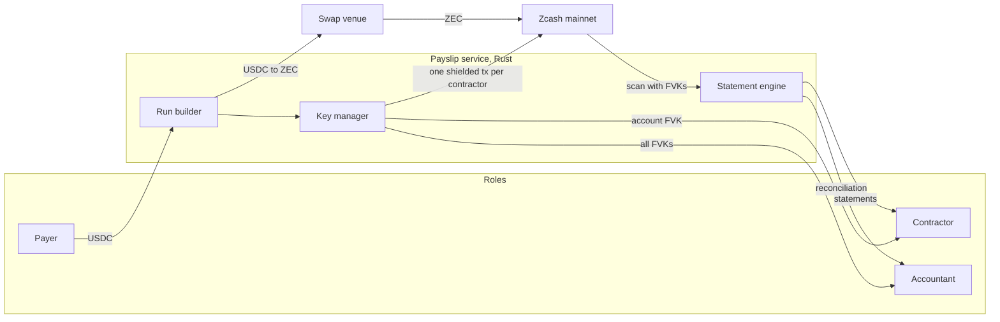

# Payslip

Private payroll on Zcash. Every payment is shielded. The contractor and the accountant each hold a viewing key that reveals exactly their slice, with USD cost basis and period statements ready for tax.

Private to the world, transparent to your accountant.

Built for the Zcash track of Colosseum's [Crypto World's Fair](https://colosseum.com/worldsfair). Submission closes 12 Oct 2026, 11:59pm PT.

## What it does

A DAO or remote-first team pays 5 to 50 contractors on-chain. Today every salary is readable on a block explorer. With Payslip:

- The payer funds a run in USDC. The service swaps to ZEC and pays each contractor with one shielded transaction from a dedicated ZIP-32 account. The memo carries run id, period, invoice reference and the USD basis at send time.
- Each contractor receives the full viewing key of their own account at onboarding. It shows their payments and nothing else, because that account pays nobody else.
- The accountant receives every account's viewing key: every run, every line, no spending power.
- The statement engine scans with those keys, decodes the memos and renders per-contractor period statements and a reconciliation view (funded USD per run against paid USD per run). CSV export, PDF via print.

There is no smart contract. Zcash has none. Payslip is a service plus a wallet library: the chain holds shielded payments and memos; the service holds keys and renders statements.

## Why Zcash, why now

- Ironwood shielded pool (NU6.3, live 28 Jul 2026): every payment lands in the newest pool.
- ZIP-32 accounts and ZIP-316 unified full viewing keys: one account per contractor is the only key arrangement where a viewing key reveals exactly one person's payments.
- ZIP-302 memos (512 bytes): enough for a structured pay line.
- NU7 (testnet 6 Oct, mainnet 5 Nov 2026): 25-second blocks for faster confirmation.

## Architecture

Full design: [docs/SPEC.md](docs/SPEC.md). Stack and reasoning: [docs/TECH-DECISIONS.md](docs/TECH-DECISIONS.md).

## Repository layout

| Path | What |
| --- | --- |
| `service/` | Rust service: wallet core on `zcash_client_backend`, run executor, swap venue client, statement engine, HTTP API |
| `web/` | Next.js dashboards for payer, contractor and accountant |
| `docs/` | Build spec, technical decisions, progress log |
| `scripts/` | Development and demo helpers |
| `CLAUDE.md` | Guide for coding agents working in this repo |

## Status

| Milestone | State |
| --- | --- |
| M0 Verify external facts | not started |
| M1 Scaffold service and web | not started |
| M2 Wallet core (accounts, FVK export, sync, send with memo) | not started |
| M3 Runs (API, swap venue, executor) | not started |
| M4 Statement engine | not started |
| M5 Web dashboards | not started |
| M6 Mainnet demo run | not started |
| M7 Submission | not started |

## Proof

Filled during M6. A judge should be able to open every item below in a Zcash explorer.

| Item | Value |
| --- | --- |
| Network | Zcash mainnet |
| Demo run id | pending M6 |
| Shielded txids (6) | pending M6 |
| Demo video | pending M6 |

## Quick start

Scaffolds land in M1. Until then see [CLAUDE.md](CLAUDE.md) for the toolchain and the milestone plan.

## How it is judged (Rules §8 and FAQ)

| Criterion | How Payslip answers it |
| --- | --- |
| Functionality | A real payroll run on Zcash mainnet, visible in the explorer as shielded transactions |
| Potential impact | On-chain payroll is public by default everywhere; the buyer is every DAO and remote team paying in crypto |
| Novelty | Per-contractor viewing keys plus a statement engine; nobody packages this on Zcash |
| UX | The user never sees a z-address; the chain is what makes amounts invisible and statements verifiable |
| Open source | This repo, MIT |
| Business plan | Per-seat monthly fee per contractor plus a spread on the stablecoin to ZEC leg |

## Disclosures

- Pre-existing code: none. Everything in this repository was written for this hackathon. Third-party libraries are dependencies listed in `Cargo.lock` and `pnpm-lock.yaml`.
- AI tools: Claude (Anthropic) via Claude Code and Cowork, used for research, specification and code generation.

## License

MIT. See [LICENSE](LICENSE).
