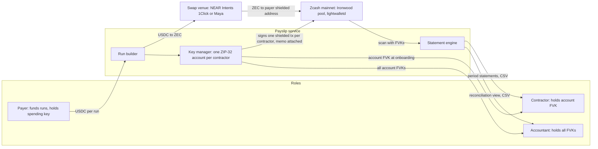

# Payslip Build Spec

Author: Pratik Kumar. Written 4 Oct 2026, moved into the repo 5 Oct 2026.

Payslip targets the Zcash track of Colosseum's Crypto World's Fair, due 13 Oct 2026, 12:29 IST (12 Oct, 11:59pm PT). Red team verdict: GO WITH CHANGES, all applied below.

## Overview

Payslip is payroll for crypto-native teams where every payment is shielded on Zcash, and the contractor and the accountant each hold a key that reveals exactly their slice, with USD cost basis and period statements ready for tax. The one-line pitch: private to the world, transparent to your accountant.

**User.** A DAO or remote-first startup paying 5 to 50 contractors on-chain. Today every salary is readable on a block explorer, or the team goes back to Deel and fiat. They switch because privacy is the default and the statements are what they currently assemble by hand.

**Why it can win.** The Zcash track is the thinnest field in the event: the sponsor's own grant proposal budgets for 50 to 100 submissions against 10 prizes, and the community thread expects most entries to be "rebranded copypasta" payment buttons. Three capabilities under 90 days old make the product real: the Ironwood shielded pool (28 Jul), Zodl's unified viewing-key export (Sep), and NU7's 25-second blocks (planned for testnet on 6 Oct, a plan the chain overtook: testnet activated NU7 at height 4,465,026 on 4 Oct; mainnet planned for 5 Nov). Past Colosseum winners include Stablecorp, Credible and Cloak, so the category has a track record; this is the version with a compliance workflow instead of a wallet.

**Prizes and judging map.**

| Criterion (Rules §8 and FAQ) | How Payslip answers it |
| --- | --- |
| Functionality | A real payroll run on Zcash mainnet, visible in the explorer as shielded transactions |
| Potential Impact | On-chain payroll is public by default everywhere; the buyer is every DAO and remote team paying in crypto |
| Novelty | Per-contractor viewing keys plus a statement engine; nobody prices or packages this on Zcash |
| UX | The chain is what makes amounts invisible and statements verifiable; contractors never need to share a key, and nobody handles a spending key |
| Open-source | Public repo, MIT |
| Business Plan | Per-seat monthly fee per contractor, plus a spread on the stablecoin to ZEC leg |
| Insight (FAQ) | Ironwood and viewing-key export turned Zcash from a coin into a selective-disclosure ledger this quarter |
| Traction (FAQ) | Run your own contractor payments through it before submission, on a separate seed from the published demo seed, and show the statements |

Track text, verbatim: "$100,000 will be awarded across 10 of the best products that integrate with the Zcash blockchain or asset." Main pool awards ($30,000 grand prize, 20 at $15,000) are judged on the same submission; no separate entry. Accelerator is Solana-only by its FAQ and is not a target for this entry.

## Architecture

There is no smart contract. Zcash has none, so Payslip is a service plus a wallet library: the chain holds shielded payments and memos, the service holds keys and renders statements.

The payer funds a run in USDC, the service converts and pays into the shielded pool, and the only way back out is a viewing key the payer chose to hand over.

### Zcash primitives used

| Primitive | What it does here | Source |
| --- | --- | --- |
| Ironwood shielded pool (NU6.3, 28 Jul 2026) | Every payment lands here; Orchard is closed to new deposits | [Ironwood is live](https://zodl.com/ironwood-is-live-on-zcash/) |
| ZIP-32 accounts | One account per contractor on the payer side; the account's full viewing key is the per-contractor key | [ZIP 32](https://zips.z.cash/zip-0032) |
| Full and incoming viewing keys | FVK shows every payment of that account, in and out; IVK shows received only. Payslip hands out FVKs | [ZIP 316 unified keys](https://zips.z.cash/zip-0316) |
| Memo field (512 bytes) | Structured pay-line memo: run id, period, invoice ref, USD basis at send | [ZIP 302 memos](https://zips.z.cash/zip-0302) |
| Unified addresses | Contractor receive address; one UA per contractor, rotated per run if the contractor opts in | [ZIP 316](https://zips.z.cash/zip-0316) |
| lightwalletd and `zcash_client_backend` (Rust) | Sync, note management, transaction building, scanning with viewing keys | [librustzcash](https://github.com/zcash/librustzcash) |
| NU7, 25-second blocks (testnet planned for 6 Oct, overtaken by activation at height 4,465,026 on 4 Oct; mainnet planned for 5 Nov) | Faster first confirmation for the demo on testnet; mainnet stays 75 s during the window | [NU7 timeline](https://forum.zcashcommunity.com/t/nu7-timeline/57655) |

### Key model

The red team's finding stands: a payer cannot derive a key that reveals only payments to one contractor. The fix is structural.

- Payer wallet = one seed, N ZIP-32 accounts, account i belongs to contractor i.
- Contractor i receives account i's full viewing key at onboarding. It shows exactly the payments made to them and nothing else, because that account pays nobody else.
- Accountant receives every account's full viewing key (or a wallet-level export). They see all runs, all lines, no spending authority.
- The spending key never leaves the payer's device or the payer's own server; the service signs with it only during a run.
- Contractor's own wallet (Zodl, Ledger with shielded support since 23 Sep) holds their receiving keys; Payslip never custodies contractor funds.

### Data model (service side, SQLite via `zcash_client_sqlite` plus app tables)

| Table | Fields |
| --- | --- |
| contractors | id, name, unified_address, zip32_account_index, settlement_choice (hold ZEC or auto-convert), fvk_shared_at |
| runs | id, period_start, period_end, funding_asset (USDC or OUSD), funding_amount, zec_acquired, zec_usd_rate, status |
| pay_lines | run_id, contractor_id, amount_zec, amount_usd_basis, memo_hash, txid, confirmed_height |
| statements | contractor_id or accountant, period, generated_at, csv_hash |

### Flows

1. **Onboard contractor.** Payer adds name, the contractor's unified address and settlement choice. Service allocates the next ZIP-32 account and emits the account FVK as a QR plus text. Contractor stores it; the accountant's export is updated.
2. **Fund a run.** Payer enters the period and USD amounts per contractor and deposits USDC (or OUSD) to the run's funding address on the swap venue's input chain.
3. **Acquire ZEC.** Service requests a quote and executes USDC to ZEC through NEAR Intents (1Click API) or Maya, delivering to the payer's shielded address. The fill rate is recorded as the run's USD basis.
4. **Pay.** Service builds one shielded transaction per contractor from that contractor's account, amount in ZEC at basis, memo encoded, and broadcasts through lightwalletd. Confirmation height is written to pay_lines.
5. **Settle (contractor side).** If the contractor chose auto-convert, their wallet or the service's agent swaps ZEC to USDC on receipt via the same venue; otherwise they hold ZEC.
6. **Scan and state.** Statement engine syncs each account with its FVK, decodes memos, joins to runs, and renders per-contractor period statements and the accountant's reconciliation view, exportable as CSV.

## Statements, settlement, demo, submission

The statement engine is the product; the shielded payment is just Zcash. Lead the video with it.

### Statement engine

- Input: one FVK per account (contractor view) or all FVKs (accountant view), synced through lightwalletd with `zcash_client_backend`.
- Each received or sent note is decoded; the memo yields run id, period, invoice ref and the USD basis written at send time. Lines with no Payslip memo are listed separately as "unlabelled" so nothing is silently dropped.
- Per-contractor period statement: date, ZEC amount, USD basis, txid, confirmed height, running totals, exported as CSV and PDF. Accountant view adds a reconciliation table: funded USD per run against paid USD per run, variance explained by the swap fill.
- Memo schema (fits 512 bytes): `PS1|<run_id>|<period YYYY-MM>|<invoice_ref>|<usd_basis_cents>|<rate_e6>`. Version prefix first so the parser can evolve.
- USD basis = the swap venue's fill rate for that run, not a spot oracle, so the statement matches what the payer actually paid.

### Settlement legs

| Leg | Venue | Why this venue |
| --- | --- | --- |
| USDC (or OUSD) to ZEC, payer side | NEAR Intents 1Click API, or Maya Protocol | Both route native ZEC today; NEAR Intents also takes USDC on several chains |
| ZEC to USDC, contractor side (optional) | Same venue, triggered on receipt | The contractor who does not want ZEC exposure gets dollars without a second app |
| Hold ZEC | Contractor's own wallet (Zodl, Ledger) | Privacy-maximal option; no conversion, no counterparty |

OUSD on Solana rail: optional, not in the pitch unless verified. Token-2022 confidential transfers hide amounts only, not parties. Check the mint before claiming anything: `spl-token display ousd2mJsPEckLHcSCDxyKD7NDGARZcfLbDZkKiatYHB` on mainnet and look for ConfidentialTransferMint; the auditor key is set by the issuer, not by Payslip.

### 90-second demo script

1. Payer dashboard: a run with 6 contractors, USD amounts, a USDC balance. Click Run.
2. Progress: USDC to ZEC fill at a shown rate, six shielded transactions broadcast, run marked complete with USD basis per line.
3. Block explorer: six shielded transactions, no amounts, no parties.
4. One contractor's wallet: her payment, memo decoded to "Sep 2026, invoice 14", and her settlement choice already executed to USDC.
5. Accountant view: period statement across all six, reconciled to the funded amount, CSV export.
6. Close on one line: private to the world, transparent to your accountant.

### Submission checklist (Colosseum)

- [ ] Register every team member on colosseum.com before 12 Oct 11:59pm PT; registration and submission close at the same instant
- [ ] Public GitHub repo (open source encouraged; private allowed with access to hackathon@colosseum.com)
- [ ] Disclose any pre-existing code used (Zcash scanner or wallet code counts) in the submission form
- [ ] Presentation video, 2 to 3 minutes; product demo video, 3 minutes maximum; both in English
- [ ] Team backgrounds, location, logo, go-to-market and demand validation fields
- [ ] Track selection: Zcash; one submission per team
- [ ] Prize payout is in Phantom CASH after KYC; team leader's wallet receives it

### Risks (red team's residual list, verbatim)

- "Nobody runs payroll in ZEC." Answered on camera by the payer-side conversion and the contractor's settlement choice; still the largest objection.
- "Token-2022 confidential transfers encrypt amounts only." OUSD rail stays optional and never claims to hide parties.
- "In Zcash a payer cannot derive a key that reveals only the payments to Alice." Fixed with one account per contractor.
- "It reads as Zodl plus a CSV exporter." Fixed by leading with the statement engine and reconciliation.
- "SAME SHAPE as past winners, in a weaker version" (Stablecorp, Cloak, Credible). Open the pitch on the accountant key, not on private payments.
- "Submit to the Zcash track only; do not pursue the accelerator with this."

### VERIFY before the first feature commit

Resolve each item, record the answer with date and source in `docs/TECH-DECISIONS.md` under "Verified facts", then tick it here.

- [x] VERIFY NEAR Intents 1Click quotes USDC to native ZEC with shielded delivery, and Maya's current ZEC route status.
- [x] VERIFY `zcash_client_backend` supports Ironwood note commitment scanning in the released crate version (0.24.0 stable, 0.25.0-pre.0 pre-release as of 5 Oct); Zebra 7.0.0-rc.0 changed DB formats on 2 Oct.
- [x] VERIFY lightwalletd public endpoints that serve Ironwood (Zodl's and Zcash Foundation's), mainnet and testnet.
- [x] VERIFY whether exporting a per-account FVK from a multi-account wallet is supported by the library without exporting the wallet-level key.
- [x] VERIFY the OUSD mint extensions as above, only if the Solana rail is kept.

All five resolved on 5 Oct 2026; answers and sources are under Verified facts in `docs/TECH-DECISIONS.md`, decisions in ADR-013 to ADR-019.

## Sources

All opened on 4 Oct 2026.

- [Crypto World's Fair event page](https://colosseum.com/worldsfair)
- [Official rules PDF](https://colosseum.com/legal/Crypto%20World's%20Fair%20Hackathon%20Rules.pdf)
- [Hackathon FAQ and judging](https://colosseum.com/hackathon)
- [Accelerator FAQ, Solana integration required](https://colosseum.com/accelerator)
- [ZCG grant for the Zcash track](https://github.com/ZcashCommunityGrants/zcashcommunitygrants/issues/414)
- [ZCG forum thread on the track](https://forum.zcashcommunity.com/t/grant-proposal-colosseum-hackathon-zcash-track/57405)
- [Ironwood is live](https://zodl.com/ironwood-is-live-on-zcash/)
- [Zodl September report, viewing-key export](https://zodl.com/september-at-zodl/)
- [NU7 timeline](https://forum.zcashcommunity.com/t/nu7-timeline/57655)
- [ZIP 32 accounts](https://zips.z.cash/zip-0032), [ZIP 316 unified addresses and keys](https://zips.z.cash/zip-0316), [ZIP 302 memos](https://zips.z.cash/zip-0302)
- [librustzcash](https://github.com/zcash/librustzcash)
- [OUSD on Solana](https://solana.com/news/open-usd-is-live-on-solana), [Solana confidential balances](https://www.solana-program.com/docs/confidential-balances/overview)
- [Frontier winners](https://blog.colosseum.com/announcing-the-winners-of-the-solana-frontier-hackathon/), [Cypherpunk winners](https://blog.colosseum.com/announcing-the-winners-of-the-solana-cypherpunk-hackathon/)
